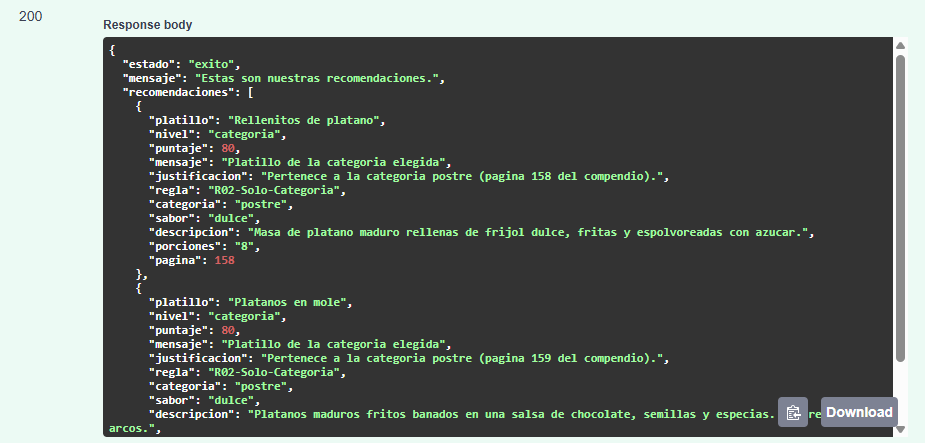
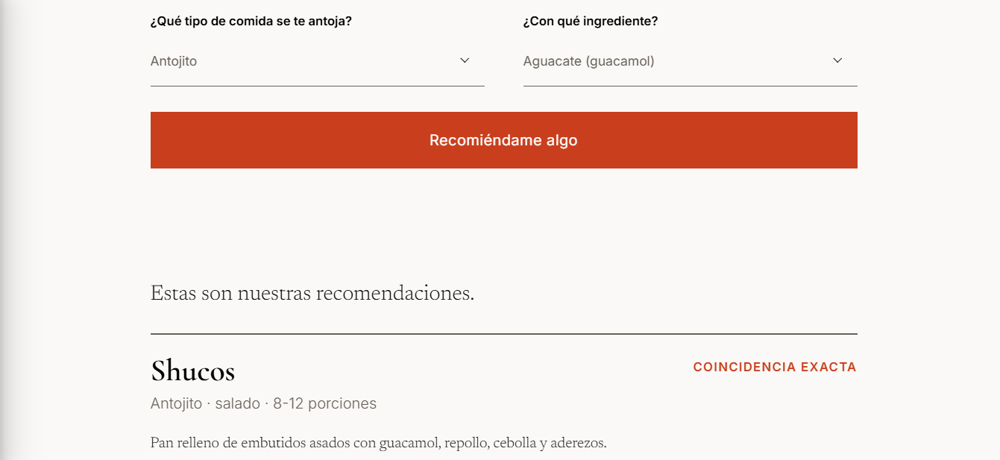
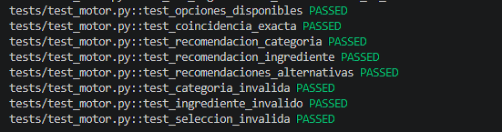
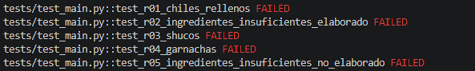

# SaborChapínExperto

Sistema de selección de comidas guatemaltecas V.1

## Descripción del proyecto

Sistema experto desarrollado en Python para recomendar comidas guatemaltecas de acuerdo con las características de la categoría y sus ingredientes disponibles.

El sistema utiliza CLIPS mediante la librería `clipspy` para procesar las reglas de conocimiento y FastAPI para exponer el motor experto mediante una API REST.

Actualmente el sistema puede recomendar:

- Shucos
- Garnachas
- Tostadas
- Rellenitos
- Plátanos en mole
- Pollo Guisado
- Puede retornar opciones secundarias, si no se cumplen las condiciones necesarias.

## 🚀 Guía para Crear y Subir tu Rama al Proyecto

Para mantener el proyecto organizado y evitar conflictos con el código de los demás, cada miembro del equipo debe trabajar en su propia rama. Sigue estos pasos en tu terminal:

### 0. Clona el repositorio
```bash
git clone https://github.com/LuisAlfred1/sistemas-expertos-proyecto.git
```

### 1. Actualizar el repositorio local
Antes de crear una rama, asegúrate de tener la última versión del código de la rama principal (`main` o `master`).
```bash
git checkout main
git pull origin main
```

### 2. Crear y cambiar a tu nueva rama
Crea tu rama usando tu nombre.
```bash
git checkout -b tu-nombre-de-rama
```

### 3. Trabajar en tus cambios y guardarlos
Realiza los cambios necesarios en tu editor de código. Cuando termines una parte, guarda tu progreso:
```bash
# Agregar los archivos al escenario
git add .

# Confirmar los cambios con un mensaje descriptivo
git commit -m "feat: descripción corta de lo que agregaste"
```

### 4. Subir la rama a GitHub
La **primera vez** que subas tu rama, debes enlazarla con el servidor remoto usando este comando:
```bash
git push -u origin tu-nombre-de-rama
```
*A partir de la segunda vez que subas cambios en esta misma rama, solo necesitarás escribir `git push`.*

### 5. Crear el Pull Request (PR) en GitHub
1. Entra al repositorio del proyecto en **GitHub**.
2. Verás un banner verde que dice **"Compare & pull request"**. Haz clic ahí.
3. Selecciona la rama **develop**, escribe brevemente tus cambios y crea el PR.


## 🌿 Estructura de ramas

```
main        ← Producción. NUNCA tocar directamente.
develop     ← Rama de integración. Aquí llegan todos los Pull Requests.
walter      ← Rama personal de walter
luis        ← Rama personal de luis
angel       ← Rama personal de angel
harleth     ← Rama personal de harleth
```

---

## Instalación

Desde la carpeta principal del proyecto, utilizar la terminal integrada de Visual Studio Code.

### Crear el entorno virtual

```bash
python -m venv .venv
```

### Activar el entorno virtual

```powershell
.\.venv\Scripts\Activate.ps1
```

### Instalar las dependencias

```bash
pip install -r backend/requirements.txt
```

### Ejecutar la API

```bash
.\.venv\Scripts\python.exe -m uvicorn backend.main:app --reload
```

Al iniciar correctamente, la API estará disponible en:

```text
http://127.0.0.1:8000
```

### Documentación interactiva

Con la API en ejecución, abrir en el navegador:

```text
http://127.0.0.1:8000/docs
```

### Captura de prueba realizada


### Pasos para renderizar en HTML

Con la API en ejecución:
- Dirigete a la carpeta `fronted` busca el archivo `index.html` 
- Entra al archivo y haz clic derecho en cualquier parte sobre el archivo y selecciona **Open with Live Server**
- Verás la página diseñada.


### Página de recomendaciones

La API se consume en la página de recomendaciones, donde el usuario escoge la categoría y un ingrediente, python procesa la solicitud y devuelve una respuesta.




## Proceso para unir los últimos cambios de la rama main

Sigue estos pasos en tu terminal para integrar los cambios más recientes de **main** en tu rama actual de trabajo de forma segura.

## 1. Asegurar tus cambios locales
Antes de moverte entre ramas o fusionar código, debes asegurarte de que tu espacio de trabajo esté limpio.
* **Opción A (Recomendada):** Si tus cambios están listos, hazles commit:
  ```bash
  git add .
  git commit -m "Guarda tus cambios actuales"
  ```
* **Opción B:** Si tus cambios están incompletos y no quieres hacer un commit todavía, guárdalos temporalmente:
  ```bash
  git stash
  ```

## 2. Descargar las últimas actualizaciones
Trae la información más reciente desde el repositorio remoto (GitHub, GitLab, etc.) sin modificar tu código local todavía:
```bash
git fetch origin
```

## 3. Asegurar tu posición en tu rama de trabajo
Confirma que te encuentras en tu rama personal para recibir los cambios de `main`:
```bash
git checkout <tu-rama>
```

## 4. Fusionar los cambios de develop
Une los cambios actualizados de la rama de desarrollo dentro de tu rama local:
```bash
git merge origin/develop
```

> 💡 **Nota sobre conflictos:** Si Git encuentra modificaciones en las mismas líneas de código que tú tocaste, detendrá el proceso y te pedirá resolver los conflictos. Una vez resueltos en tu editor de código, ejecuta `git add .` y `git commit` para finalizar la fusión.

## 5. Recuperar tus cambios guardados (Opcional)
Si en el paso 1 decidiste guardar tus cambios con `git stash`, ahora puedes traerlos de vuelta para seguir trabajando:
```bash
git stash pop
```

# Testing - 13/11/2026

Se ejecutó la suite de pruebas del proyecto usando el entorno virtual del repositorio:

```bash
python -m pytest -v
```

## Resumen general

- Total ejecutadas: 13
- Aprobadas: 8
- Fallidas: 5
- Porcentaje de aprobación: 61.54%

> [!IMPORTANT]
> La versión actual del motor experto y de la lógica implementada en `conocimientoV2.clp` quedó validada en la mayoría de los casos; los fallos actuales corresponden a pruebas heredadas de una versión anterior del proyecto (`test_main.py`) que apuntan a rutas y reglas ya no vigentes.

## Pruebas aprobadas (`tests/test_motor.py`)

| Prueba | Entradas | Resultado esperado | Resultado obtenido | Estado |
|---|---|---|---|---|
| `test_opciones_disponibles` | `obtener_opciones()` | Debe devolver categorías `antojito`, `plato_fuerte`, `postre` e ingredientes clave (`pollo`, `tortilla`, `platano`) | Las categorías e ingredientes coinciden con la estructura esperada | Aprobada |
| `test_coincidencia_exacta` | `("antojito", "tortilla")` | Estado `exito`, platillos `{Tostadas de guacamol, Garnachas}`, regla `R01-Coincidencia-Exacta`, puntaje 100 | Coincide exactamente con el resultado esperado | Aprobada |
| `test_recomendacion_categoria` | `("plato_fuerte", "cualquiera")` | Debe devolver recomendación por categoría y regla `R02-Solo-Categoria` | Se obtiene `Pollo guisado` con nivel `categoria` | Aprobada |
| `test_recomendacion_ingrediente` | `("cualquiera", "canela")` | Debe devolver los platillos que contienen `canela` y regla `R03-Solo-Ingrediente` | Los resultados coinciden con los platillos esperados | Aprobada |
| `test_recomendaciones_alternativas` | `("antojito", "pollo")` | Debe devolver alternativas con nivel `alternativa`, puntaje 50 y reglas `R04-Alternativa-Por-Categoria` / `R05-Alternativa-Por-Ingrediente` | Las alternativas coinciden con los nombres esperados y sus reglas | Aprobada |
| `test_categoria_invalida` | `("comida", "tortilla")` | Debe lanzar `ValueError` | Se lanzó correctamente la excepción | Aprobada |
| `test_ingrediente_invalido` | `("antojito", "pizza")` | Debe lanzar `ValueError` | Se lanzó correctamente la excepción | Aprobada |
| `test_seleccion_invalida` | `("cualquiera", "cualquiera")` | Debe lanzar `ValueError` | Se lanzó correctamente la excepción | Aprobada |

## Pruebas fallidas (`tests/test_main.py`)

Estas pruebas pertenecen a la versión 1 del sistema y ya no son compatibles con la versión actual del proyecto basada en `conocimientoV2.clp`.

| Prueba | Entradas | Resultado esperado | Resultado obtenido | Estado |
|---|---|---|---|---|
| `test_r01_chiles_rellenos` | `POST /api/v1/evaluar` con JSON `{elaborado: true, lleva_carne: true, base_pan: false, tortilla: false, ingredientes_disponibles: []}` | `status_code == 200` y resultado `Chiles Rellenos` con regla `R01-Ofrecer-Chiles-Rellenos` | `404 Not Found` | Fallida |
| `test_r02_ingredientes_insuficientes_elaborado` | `POST /api/v1/evaluar` con JSON `{elaborado: true, lleva_carne: false, base_pan: false, tortilla: false, ingredientes_disponibles: []}` | `status_code == 200` y `estado == ingrediente_insuficientes` | `404 Not Found` | Fallida |
| `test_r03_shucos` | `POST /api/v1/evaluar` con JSON `{elaborado: false, lleva_carne: false, base_pan: true, tortilla: false, ingredientes_disponibles: []}` | `status_code == 200` y resultado `Shucos` con regla `R03-Ofrecer-Shucos` | `404 Not Found` | Fallida |
| `test_r04_garnachas` | `POST /api/v1/evaluar` con JSON `{elaborado: false, lleva_carne: false, base_pan: false, tortilla: true, ingredientes_disponibles: []}` | `status_code == 200` y resultado `Garnachas` con regla `R04-Ofrecer-Garnachas` | `404 Not Found` | Fallida |
| `test_r05_ingredientes_insuficientes_no_elaborado` | `POST /api/v1/evaluar` con JSON `{elaborado: false, lleva_carne: false, base_pan: false, tortilla: false, ingredientes_disponibles: []}` | `status_code == 200` y `estado == ingrediente_insuficientes` | `404 Not Found` | Fallida |

## Evidencia visual





## Conclusión

La lógica del motor experto actual quedó validada en la mayoría de sus escenarios. Las pruebas que fallan pertenecen a una implementación antigua del backend (`test_main.py`), no a la versión actual del motor de recomendaciones, y por ello se debe considerar que no representan un error funcional del sistema actualizado, sino una desactualización de pruebas y rutas API.